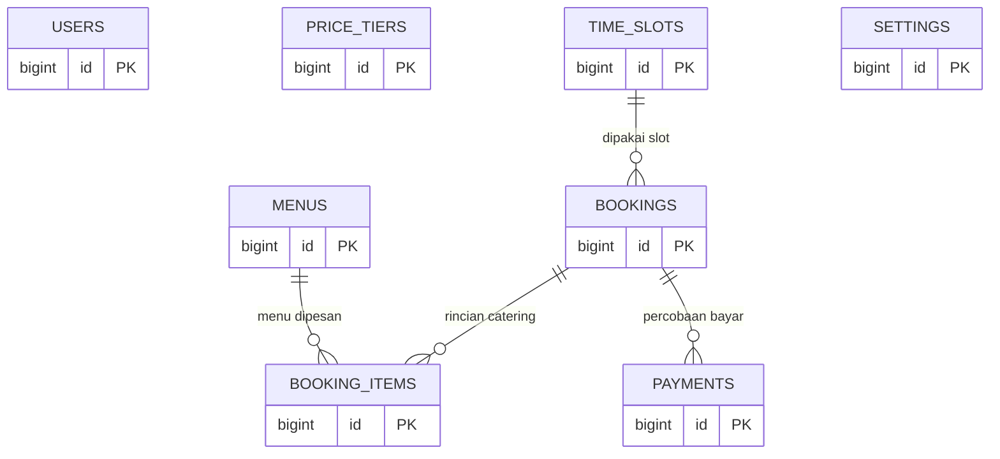

# KIMJO — Skema Database

**Status:** final — 15 November 2026
**Peran dokumen:** acuan pembuatan migration dan model. Aturan bisnis tidak diulang di sini — rujuk `PRD.md` (BR-xx). Bila dokumen ini dan PRD berbeda, PRD menang.

Database: **MySQL**, charset `utf8mb4`, collation `utf8mb4_unicode_ci`, timezone aplikasi Asia/Jakarta. Semua nominal uang: **integer rupiah penuh** (`unsignedInteger`), tanpa desimal.

---

## 1. Daftar Tabel

| # | Tabel | Model | Fungsi |
|---|---|---|---|
| 1 | `users` | `User` | Akun admin |
| 2 | `menus` | `Menu` | Menu coffeeshop **dan** menu catering |
| 3 | `price_tiers` | `PriceTier` | Tingkatan tarif reservasi per orang (BR-01) |
| 4 | `time_slots` | `TimeSlot` | Slot waktu & kapasitas (BR-05) |
| 5 | `bookings` | `Booking` | Kepala pesanan |
| 6 | `booking_items` | `BookingItem` | Rincian item catering |
| 7 | `payments` | `Payment` | Transaksi Midtrans per booking |
| 8 | `settings` | `Setting` | Teks & gambar halaman publik |

Urutan migration: `users` → `menus` → `price_tiers` → `time_slots` → `bookings` → `booking_items` → `payments` → `settings`.

---

## 2. Relasi

```
users            (berdiri sendiri, tanpa relasi ke tabel lain)

price_tiers      (berdiri sendiri; dipakai saat menghitung total)

time_slots  1 ──< bookings

menus       1 ──< booking_items >── 1 bookings
                                    │
                  bookings 1 ──< payments

settings         (berdiri sendiri, key-value)
```



Catatan penting:

- **`menus` menampung dua jenis menu.** Pembedanya kolom `jenis` (`coffeeshop` / `catering`). Kolom `hari` hanya diisi untuk catering dan **wajib** untuk catering (FR-A-04), `NULL` untuk coffeeshop.
- **`time_slots` tidak punya kolom sisa kapasitas.** Pemakaian slot dihitung dari `SUM(bookings.jumlah_orang)` pada tanggal + slot yang sama dengan status yang masih menahan slot (lihat bagian 9).
- **`menus.harga` adalah harga satuan**: harga produk coffeeshop, atau harga per porsi catering. Total catering = Σ(`booking_items.harga_satuan` × `jumlah`).
- Harga dan tarif **disalin** ke baris pesanan (`booking_items`, `bookings.total_harga`) supaya perubahan menu tidak mengubah pesanan lama (FR-A-06).

---

## 3. `users`

| Kolom | Tipe | Null | Default | Keterangan |
|---|---|---|---|---|
| `id` | `bigIncrements` | tidak | — | PK |
| `name` | `string(100)` | tidak | — | Nama admin |
| `email` | `string(150)` | tidak | — | **unique** |
| `email_verified_at` | `timestamp` | ya | `NULL` | Bawaan Laravel, tidak dipakai |
| `password` | `string` | tidak | — | Hash bcrypt |
| `role` | `string(20)` | tidak | `'admin'` | Satu tingkat role saja (PRD bagian 3) |
| `remember_token` | `string(100)` | ya | `NULL` | Bawaan Laravel |
| `created_at` | `timestamp` | ya | `NULL` | |
| `updated_at` | `timestamp` | ya | `NULL` | |

Index: `email` unique. Tabel `password_reset_tokens` dan `sessions` tetap dipakai dari bawaan Laravel.

---

## 4. `menus`

| Kolom | Tipe | Null | Default | Keterangan |
|---|---|---|---|---|
| `id` | `bigIncrements` | tidak | — | PK |
| `jenis` | `string(20)` | tidak | — | `coffeeshop` \| `catering` |
| `nama` | `string(100)` | tidak | — | Nama menu |
| `deskripsi` | `text` | ya | `NULL` | |
| `harga` | `unsignedInteger` | tidak | — | Rupiah penuh, harga satuan |
| `kategori` | `string(30)` | ya | `NULL` | Khusus coffeeshop: `kopi`, `non-kopi`, `makanan-ringan` |
| `hari` | `string(10)` | ya | `NULL` | Khusus catering: `senin`…`jumat` |
| `foto` | `string(255)` | ya | `NULL` | Path relatif di `storage/app/public` |
| `is_active` | `boolean` | tidak | `true` | Nonaktif tidak tampil di publik |
| `urutan` | `unsignedSmallInteger` | tidak | `0` | Urutan tampil |
| `created_at` | `timestamp` | ya | `NULL` | |
| `updated_at` | `timestamp` | ya | `NULL` | |

Index: `(jenis, is_active)`, `hari`, `urutan`.

Aturan aplikasi (bukan constraint DB):
- `hari` wajib bila `jenis = 'catering'`; harus `NULL` bila `coffeeshop`.
- `kategori` wajib untuk coffeeshop (nilai salah satu dari tiga di atas).
- Menu yang sudah dipakai `booking_items` **tidak dihapus keras**; cukup `is_active = false`.

---

## 5. `price_tiers`

| Kolom | Tipe | Null | Default | Keterangan |
|---|---|---|---|---|
| `id` | `bigIncrements` | tidak | — | PK |
| `label` | `string(50)` | ya | `NULL` | Contoh: `1–5 orang` |
| `min_orang` | `unsignedSmallInteger` | tidak | — | Batas bawah (inklusif) |
| `max_orang` | `unsignedSmallInteger` | ya | `NULL` | Batas atas (inklusif); `NULL` = tanpa batas |
| `tarif_per_orang` | `unsignedInteger` | tidak | — | Rupiah penuh |
| `is_active` | `boolean` | tidak | `true` | |
| `created_at` | `timestamp` | ya | `NULL` | |
| `updated_at` | `timestamp` | ya | `NULL` | |

Seeder mengisi sesuai BR-01: `1–5 → 50000`, `6–10 → 45000`, `11–NULL → 40000`.
Pemilihan tier: cari baris aktif dengan `min_orang <= jumlah_orang` dan (`max_orang IS NULL` atau `jumlah_orang <= max_orang`). Tarif **tidak berlapis** (BR-01).

---

## 6. `time_slots`

| Kolom | Tipe | Null | Default | Keterangan |
|---|---|---|---|---|
| `id` | `bigIncrements` | tidak | — | PK |
| `jam_mulai` | `time` | tidak | — | Contoh `10:00:00` |
| `jam_selesai` | `time` | tidak | — | Contoh `12:00:00` |
| `kapasitas` | `unsignedSmallInteger` | tidak | `30` | Jumlah orang per slot (BR-05) |
| `is_active` | `boolean` | tidak | `true` | Nonaktif tidak muncul di form (FR-A-05) |
| `created_at` | `timestamp` | ya | `NULL` | |
| `updated_at` | `timestamp` | ya | `NULL` | |

Index: `(is_active, jam_mulai)`.
Seeder mengisi 4 slot sesuai BR-05: 10:00–12:00, 13:00–15:00, 16:00–18:00, 19:00–21:00, semuanya kapasitas 30.
Tidak ada unique constraint pada jam, supaya admin bisa menambah slot lain di masa depan.

---

## 7. `bookings`

| Kolom | Tipe | Null | Default | Keterangan |
|---|---|---|---|---|
| `id` | `bigIncrements` | tidak | — | PK |
| `kode_booking` | `string(20)` | tidak | — | **unique**, format `KIMJO-XXXXXX` (FR-P-07) |
| `jenis` | `string(20)` | tidak | — | `coffeeshop` \| `catering` |
| `nama_pelanggan` | `string(100)` | tidak | — | |
| `no_whatsapp` | `string(20)` | tidak | — | Disimpan apa adanya, ditampilkan tersamar (FR-P-08) |
| `catatan` | `text` | ya | `NULL` | |
| `tanggal_reservasi` | `date` | tidak | — | Tanggal kunjungan / pengiriman |
| `time_slot_id` | `bigInteger` FK | ya | `NULL` | Wajib untuk coffeeshop, `NULL` untuk catering → `time_slots.id` `restrictOnDelete` |
| `jumlah_orang` | `unsignedSmallInteger` | ya | `NULL` | Wajib untuk coffeeshop, `NULL` untuk catering |
| `total_harga` | `unsignedInteger` | tidak | — | Nominal final, sudah dihitung saat submit |
| `status` | `string(30)` | tidak | `'menunggu_pembayaran'` | Salah satu dari PRD bagian 7 |
| `alasan_pembatalan` | `text` | ya | `NULL` | Wajib diisi saat admin membatalkan (FR-A-07) |
| `expires_at` | `datetime` | tidak | — | `created_at + 15 menit` (BR-04) |
| `created_at` | `timestamp` | ya | `NULL` | |
| `updated_at` | `timestamp` | ya | `NULL` | |

Index: `kode_booking` unique, `status`, `tanggal_reservasi`, `(tanggal_reservasi, time_slot_id)`, `expires_at` (untuk scheduler), `jenis`.

Kolom turunan yang **tidak** disimpan: sisa kapasitas slot, tarif per orang yang dipakai, jumlah item catering. Semuanya dihitung dari tabel lain.

---

## 8. `booking_items`

Hanya terisi untuk `jenis = 'catering'`. Reservasi coffeeshop tidak membuat baris di sini.

| Kolom | Tipe | Null | Default | Keterangan |
|---|---|---|---|---|
| `id` | `bigIncrements` | tidak | — | PK |
| `booking_id` | `bigInteger` FK | tidak | — | → `bookings.id` **cascadeOnDelete** |
| `menu_id` | `bigInteger` FK | tidak | — | → `menus.id` **restrictOnDelete** |
| `nama_menu` | `string(100)` | tidak | — | Salinan nama saat dipesan |
| `harga_satuan` | `unsignedInteger` | tidak | — | Salinan harga saat dipesan |
| `jumlah` | `unsignedSmallInteger` | tidak | — | Jumlah porsi |
| `subtotal` | `unsignedInteger` | tidak | — | `harga_satuan × jumlah` |
| `created_at` | `timestamp` | ya | `NULL` | |
| `updated_at` | `timestamp` | ya | `NULL` | |

Index: `booking_id`, `menu_id`.

Satu menu hanya muncul **satu baris** per booking; bila pelanggan memilih menu yang sama, jumlahnya digabung sebelum disimpan.

---

## 9. `payments`

Satu booking bisa punya lebih dari satu baris (percobaan bayar ulang). Hanya baris terbaru yang dipakai.

| Kolom | Tipe | Null | Default | Keterangan |
|---|---|---|---|---|
| `id` | `bigIncrements` | tidak | — | PK |
| `booking_id` | `bigInteger` FK | tidak | — | → `bookings.id` **cascadeOnDelete** |
| `order_id` | `string(50)` | tidak | — | **unique**, `KIMJO-XXXXXX-<timestamp>` (FR-S-01) |
| `transaction_id` | `string(100)` | ya | `NULL` | Dari Midtrans |
| `snap_token` | `string(255)` | ya | `NULL` | Token popup Snap |
| `snap_redirect_url` | `string(255)` | ya | `NULL` | Cadangan bila popup gagal |
| `metode_pembayaran` | `string(50)` | ya | `NULL` | `payment_type` Midtrans: `qris`, `bank_transfer`, `gopay`, dst. |
| `gross_amount` | `unsignedInteger` | tidak | — | Harus sama dengan `bookings.total_harga` |
| `status` | `string(20)` | tidak | `'pending'` | `pending` \| `settlement` \| `capture` \| `deny` \| `expire` \| `cancel` \| `failure` |
| `payload` | `json` | ya | `NULL` | Body notifikasi terakhir, untuk audit |
| `paid_at` | `datetime` | ya | `NULL` | Diisi saat settlement/capture |
| `created_at` | `timestamp` | ya | `NULL` | |
| `updated_at` | `timestamp` | ya | `NULL` | |

Index: `order_id` unique, `booking_id`, `status`, `transaction_id`.

Catatan:
- `status` di tabel ini adalah status **transaksi gateway**, berbeda dari `bookings.status` (status pesanan). Jangan menyamakan keduanya.
- Tidak ada kolom bukti transfer; semua bukti berasal dari gateway.
- `payload` berguna saat webhook ganda atau sengketa.

---

## 10. `settings`

Teks & gambar halaman publik, dikelola dari FR-A-08.

| Kolom | Tipe | Null | Default | Keterangan |
|---|---|---|---|---|
| `id` | `bigIncrements` | tidak | — | PK |
| `key` | `string(100)` | tidak | — | **unique**, contoh `beranda.hero_judul` |
| `value` | `text` | ya | `NULL` | Teks atau path gambar |
| `grup` | `string(50)` | tidak | `'umum'` | `beranda`, `tentang`, `kontak`, `umum` |
| `tipe` | `string(20)` | tidak | `'text'` | `text` \| `textarea` \| `image` \| `url` |
| `label` | `string(150)` | ya | `NULL` | Label di form admin |
| `created_at` | `timestamp` | ya | `NULL` | |
| `updated_at` | `timestamp` | ya | `NULL` | |

Index: `key` unique, `grup`.

Nilai gambar disimpan sebagai path relatif (`beranda/hero.jpg`) di `storage/app/public`; view memakai `Storage::url()`.
Key awal yang wajib dibuat seeder:

| Grup | Key |
|---|---|
| beranda | `beranda.hero_judul`, `beranda.hero_subjudul`, `beranda.hero_gambar`, `beranda.tentang_ringkas`, `beranda.gambar_galeri_1..3` |
| tentang | `tentang.judul`, `tentang.isi`, `tentang.alamat`, `tentang.jam_buka`, `tentang.maps_url` |
| kontak | `kontak.whatsapp`, `kontak.email`, `kontak.instagram`, `kontak.tiktok` |

---

## 11. Perhitungan Kapasitas Slot

Tidak ada tabel/kolom khusus. Saat memesan slot coffeeshop:

```sql
SELECT COALESCE(SUM(jumlah_orang), 0)
FROM bookings
WHERE tanggal_reservasi = ?
  AND time_slot_id = ?
  AND status IN ('menunggu_pembayaran', 'dibayar', 'diproses')
  FOR UPDATE;
```

- Status penahan slot: `menunggu_pembayaran`, `dibayar`, `diproses` (PRD bagian 7).
- Slot dilepas saat `kedaluwarsa`, `gagal`, `dibatalkan` — cukup dengan status tersebut tidak masuk query di atas.
- Pengecekan dan insert harus dalam satu transaksi database dengan row lock, agar dua pelanggan yang submit bersamaan tidak overbooking (BR-10).
- Query dijalankan di dalam `DB::transaction()`.

---

## 12. Data Contoh (Seeder)

| Seeder | Isi |
|---|---|
| `AdminSeeder` | 1 user dari `ADMIN_EMAIL`/`ADMIN_PASSWORD`, role `admin` |
| `PriceTierSeeder` | 3 tier BR-01 |
| `TimeSlotSeeder` | 4 slot BR-05 |
| `MenuSeeder` | ±8 menu coffeeshop + 1–3 menu catering per hari Senin–Jumat |
| `SettingSeeder` | semua key pada bagian 10 dengan teks placeholder yang wajar |

Seeder tidak membuat booking/payment contoh.

---

## 13. Hal yang Sengaja Tidak Ada di Versi 1

`catering_packages`, `payments.file_bukti`, kolom `sisa_kapasitas`, tabel `blocked_dates`, soft delete, tabel pelanggan, tabel promo/voucher, tabel stok, multi-cabang. Alasan: di luar `PRD.md` bagian 11 atau sudah digantikan aturan lain.
